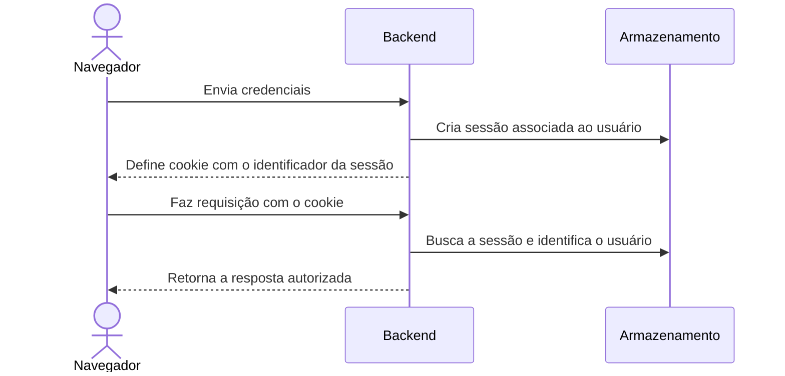

Em projetos web, uma **sessão** permite que o servidor reconheça o mesmo usuário em várias requisições. Isso é necessário porque o HTTP, por padrão, trata cada requisição como independente: o servidor não se lembra automaticamente de quem fez a requisição anterior.

### Fluxo típico

Em termos simples:

1. O usuário entra no sistema.
2. O backend valida as credenciais e cria uma sessão, normalmente com um identificador aleatório.
3. O navegador recebe esse identificador em um **cookie**.
4. Nas próximas requisições, o navegador envia o cookie automaticamente.
5. O backend usa o identificador para encontrar a sessão e saber qual usuário está fazendo a requisição.
6. Ao sair, a sessão é invalidada e o cookie é removido.

O cookie costuma guardar apenas o identificador da sessão. Os dados associados — por exemplo, o ID do usuário e o prazo de validade — ficam no servidor, em um banco ou armazenamento como Redis.

### Sessão não é exatamente a mesma coisa que autenticação

- **Autenticação** verifica quem é o usuário.
- **Sessão** mantém essa identificação entre várias requisições.
- **Autorização** decide o que esse usuário pode fazer.

Uma sessão também pode guardar informações de visitantes não autenticados, como um carrinho de compras.

### Cuidados importantes

Como o cookie identifica a sessão, quem obtiver esse valor pode tentar usá-la. Por isso, é comum:

- marcar o cookie como `HttpOnly`, para reduzir o acesso por JavaScript;
- usar `Secure`, para enviá-lo apenas por HTTPS;
- configurar `SameSite` e proteger operações contra CSRF;
- criar um novo identificador após o login;
- definir expiração e invalidar a sessão no logout.

No script local da Iara que você mostrou anteriormente, a ideia segue esse modelo: o cookie `iara_sessao` identifica a sessão, e o backend relaciona essa sessão à identidade armazenada. O token de CSRF tem outra função: ajudar a proteger operações que alteram dados.

Uma alternativa comum é usar tokens como JWT. Em vez de consultar uma sessão armazenada no servidor a cada requisição, o servidor valida o próprio token. Cada abordagem tem custos diferentes, especialmente para revogar acessos e compartilhar sessões entre várias instâncias do backend.
