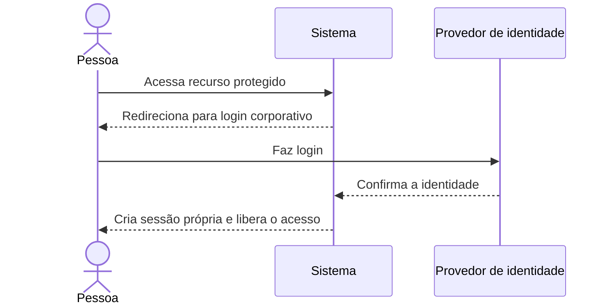

**SSO** significa *Single Sign-On*, ou **login único**. A pessoa entra uma vez por meio de um provedor de identidade e pode acessar vários sistemas que confiam nesse provedor, sem digitar a senha em cada um.

Por exemplo: a empresa usa uma conta corporativa para acessar o e-mail, o Grafana e sistemas internos.

### Como funciona

1. Você tenta acessar um sistema, como o Grafana.
2. O sistema percebe que você ainda não está autenticado e encaminha o navegador ao **provedor de identidade** — por exemplo, o serviço de login corporativo.
3. O provedor verifica sua identidade, talvez com senha e autenticação multifator.
4. Ele informa ao Grafana que o login foi confirmado.
5. O Grafana valida essa resposta e cria a própria sessão para manter você conectado.
6. Ao acessar outro sistema integrado, o navegador pode voltar ao provedor. Se o login corporativo ainda estiver ativo, ele confirma sua identidade sem pedir a senha novamente.

### SSO não significa acesso irrestrito

O provedor confirma **quem você é**. Cada sistema ainda decide **o que você pode fazer**. Por exemplo, o SSO pode permitir a entrada no Grafana, enquanto as permissões do Grafana determinam quais painéis você pode visualizar.

Também são conceitos diferentes:

- **SSO:** permite usar um login centralizado em vários sistemas.
- **Sessão local:** mantém você conectado a um sistema específico depois que o login foi confirmado.
- **Autorização:** define quais ações sua conta pode executar.

### Protocolos comuns

- **OpenID Connect (OIDC):** usado com frequência em integrações modernas de login. É uma camada de identidade construída sobre OAuth 2.0.
- **SAML:** comum em integrações corporativas e sistemas mais antigos.

Uma distinção importante: **OAuth 2.0**, por si só, trata principalmente de autorização para acessar recursos. Para autenticar uma pessoa com esse tipo de integração, é comum usar OIDC.

No contexto da Iara, por exemplo, um provedor corporativo ou o SULTS poderia confirmar a identidade por SSO. Depois, a Iara ainda poderia criar sua própria sessão e aplicar as permissões necessárias às conversas e operações. O login centralizado não substitui essas regras.
